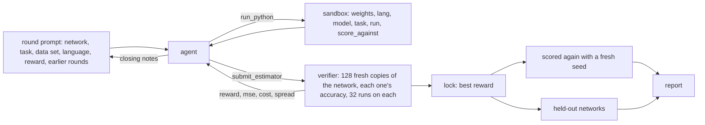

# ARC-agent

## Big picture

In this repo we consider an automated, agentic hill-climbing approach to the agenda of ARC (the Alignment
Research Center): explaining a network by **estimating its behaviour mechanistically**, from its weights, and
asking that such an estimate compete with random sampling at the same compute
([Competing with sampling](https://www.alignment.org/blog/competing-with-sampling/)). ARC's AlgZoo publishes tiny
networks with exactly this as the challenge: estimate the accuracy of a 432-parameter RNN better than sampling does
for the same compute ([AlgZoo](https://www.alignment.org/blog/algzoo-uninterpreted-models-with-fewer-than-1-500-parameters/)).

Here an agent writes an **estimator** of a network's accuracy, a verifier measures how far its estimates are from
the truth and how much compute they take, and the agent climbs that score round after round. It is the same
setup as [Mech-Interp-Agent-level1](https://github.com/WFJKK/Mech-Interp-Agent-level1), whose sandbox, backends and
priced language this repo builds on; there the agent wrote a cheaper predictor of the network's outputs, here it
writes a cheaper estimate of its accuracy.

## More formally

We have a network $M$, a data set $D$ (a distribution over inputs) and a task $y$. The network's accuracy is

```math
A = P_{x \sim D}\big(M(x) = y(x)\big).
```

An estimator $G$ is a program that computes one number, $\hat A$, from the network's weights; it may also draw
random numbers. It is written in a small language of priced operations
([`agent_docs/ESTIMATOR.md`](agent_docs/ESTIMATOR.md)), in which the network itself is written too, so that both are
priced by the same list. One run of $G$ spends $C$ forward-pass equivalents: its scalar operations over those of one
forward pass of $M$. Nothing of an estimator runs as code; the verifier interprets it, so it can do no work that
is not counted.

The verifier measures $A$ on inputs of its own, runs $G$ many times with fresh seeds, and keeps the error and the
cost of every run. Nothing is proved: an estimator is checked by measuring it.

## Reward function

### What we use

The agent's job is to estimate how often one fixed model gets the right answer. It gets a higher reward when its
estimate is closer to the verifier's accuracy and when it uses less compute.

```math
R_\lambda = -(\hat A - A_{\mathrm{verifier}})^2 - \lambda C
```

We calculate it in three steps.

1. **Measure the model's accuracy.** The verifier runs the checkpoint on labeled inputs and counts the fraction
   correct. For the 432-parameter AlgZoo RNN, it measured 95.3006% on 2,097,152 fresh inputs, and the worked
   example below uses $A_{\mathrm{verifier}} = 0.953006$. (This repo's verifier draws its own 2,097,152 inputs, with
   seed 20261124, and measures 0.953078: half a standard error away, which is 0.0146 points.)
2. **Score the agent's estimate.** The agent's estimator returns one number, $\hat A$. We take its difference from
   the reference and square it. Being one percentage point too high or too low gives the same penalty,
   $0.01^2 = 0.0001$.
3. **Charge for compute.** $C$ is the estimated number of scalar operations used to produce that estimate, divided
   by the cost of one ordinary model forward pass (2,937 operations for this RNN). At $\lambda = 10^{-6}$, 100
   forward-pass equivalents cost $0.0001$ reward. So spending 100 extra passes to eliminate a one-percentage-point
   error exactly breaks even.

**Worked example from round five.** We ran the RNN estimator 4,096 times with fresh randomness on the same
checkpoint. We squared the error of each estimate, then averaged. Its root mean squared error was 1.286 percentage
points, and its average cost was 109.86 forward-pass equivalents. Its average reward was therefore

```math
\bar R \approx -(0.0128565)^2 - 10^{-6} \cdot 109.86 = -0.00027515.
```

Higher is better. Monte Carlo enters afterward as a benchmark. At that same compute budget, ordinary Monte Carlo
had 2.031 percentage points of root mean squared error, so the agent's estimator achieved 59.9% lower mean squared
error.

For mechanistic understanding, the important limitation is that the formula scores only the estimate and its cost.
On this very checkpoint, the constant guess 95% missed by just 0.301 percentage points and earned a higher reward.

In code: `r_lambda` in [`arcagent/rewards.py`](arcagent/rewards.py), with `lam: 1.0e-6` in
[`config/defaults.yaml`](config/defaults.yaml). The verifier ([`arcagent/verifier.py`](arcagent/verifier.py)) runs
every submitted estimator 4,096 times, each run with the seed `[seed, k]` for a `seed` it draws afresh, and the
reward is the mean over the runs: $-\mathrm{mse} - \lambda \bar C$. Every receipt keeps the parts (mean squared
error, bias, spread of the estimates, mean, least and most cost, random draws per run), so a finished run can be
scored again under another $\lambda$ (`python -m arcagent.loop rescore`). The benchmark is computed for every
receipt but never shown to the agent: at mean cost $C$, plain sampling can afford $n = C/s$ inputs, where one more
sampled input costs $s = 2{,}989/2{,}937 = 1.0177$ forward passes here (ten draws, a forward pass, the task's answer,
a comparison), and its mean squared error is $A(1-A)/n$. Under $R_\lambda$ the best plain sampling takes
$n^* = \sqrt{A(1-A)/(\lambda s)}$ inputs and scores $-2\sqrt{\lambda s A(1-A)}$.

`docs/REWARD.md` has the details, the ways a reward like this can be gamed and what stops each.

### Measured here

The verifier's own numbers on the challenge network and on the held-out networks of the pilot (`models/rnn-g`;
reproduce with `python -m arcagent.report --model models/rnn-g --network rnn-g-s0`). Accuracies on 2,097,152
inputs; "sampling" is plain sampling, its error from $A(1-A)/n$; $\lambda = 10^{-6}$.

| Network | Accuracy | Constant 0.95: error (points) | Constant 0.95: reward | Sampling, 108 inputs (109.9 passes): rms error (points) | Its reward | Best sampling: inputs | Its reward |
| --- | ---: | ---: | ---: | ---: | ---: | ---: | ---: |
| rnn-g-s0 (the challenge network) | 0.953078 | -0.31 | -9.47e-06 | 2.035 | -5.24e-04 | 210 | -4.27e-04 |
| rnn-g-z0 | 0.909862 | +4.01 | -1.61e-03 | 2.756 | -8.69e-04 | 284 | -5.78e-04 |
| rnn-g-z1 | 0.880417 | +6.96 | -4.84e-03 | 3.122 | -1.09e-03 | 322 | -6.55e-04 |
| rnn-g-z2 | 0.948575 | +0.14 | -2.03e-06 | 2.125 | -5.62e-04 | 219 | -4.46e-04 |
| rnn-g-z3 | 0.931835 | +1.82 | -3.30e-04 | 2.425 | -6.98e-04 | 250 | -5.09e-04 |
| rnn-g-z4 | 0.889638 | +6.04 | -3.64e-03 | 3.015 | -1.02e-03 | 311 | -6.32e-04 |
| rnn-g-n1 | 0.944583 | +0.54 | -2.93e-05 | 2.202 | -5.95e-04 | 227 | -4.62e-04 |
| rnn-g-n2 | 0.845580 | +10.44 | -1.09e-02 | 3.477 | -1.32e-03 | 358 | -7.29e-04 |
| rnn-g-n3 | 0.693744 | +25.63 | -6.57e-02 | 4.435 | -2.08e-03 | 457 | -9.30e-04 |

- **The worked example's numbers come out here too.** Plain sampling of 108 inputs costs 109.9 forward passes; run
  4,096 times through the verifier it had 2.029 points of rms error (seed 1) and 2.085 (seed 0), against 2.035 from
  the formula and the 2.031 of the write-up. The constant 0.95 misses by 0.308 points here (0.301 against 0.953006).
- **The round-five estimator beats the best plain sampling** under $R_\lambda$: -2.75e-4 against -4.27e-4.
- **The constant shows the limitation.** It is the best entry in the table on the challenge network and on z2,
  whose accuracy happens to be close to 95%, and the worst by far on n2 and n3. Its mean reward over the eight
  held-out networks is -1.09e-2, against -6.2e-4 for the best plain sampling.

### Scored on copies of the network

The cost term is there so that brute force does not pay: an estimator that samples a million inputs is charged a
million forward passes. But $C$ counts the operations of the estimator that is submitted, and nothing the agent ran
before. Its own code may run the network as often as it likes, and what that finds fits into an estimator as one
number, at no operations. So on the one network the agent holds, the best "estimator" is the measured accuracy
written in as a constant: on rnn-b-s0, rounded to four places, it scores -2e-9, and nothing that estimates can
come near it. The reward would have a summit with no hill.

A scoring is therefore not made on that network but on **copies** of it
([`arcagent/measure.py`](arcagent/measure.py)):

- **A copy** is the network with a few of its weights changed at random: every weight is changed with probability
  `share`, by a normal draw of `size` times the root mean square of its weight matrix. The other weights stay as
  they are, bit for bit, and a weight that is exactly zero (the slot that holds no token) is never changed.
- **Every scoring makes its own copies**, 128 of them, from a seed the verifier draws afresh. It measures each
  copy's accuracy (65,536 inputs, or every input where the data set has no more), runs the estimator 32 times on
  each copy, and takes a run's error against the accuracy of the copy it ran on. The reward is the same formula
  over all 4,096 runs.
- What an estimator computes from the weights follows a copy. A number written into it does not: its error is the
  distance from the copy's accuracy, whatever the number.
- **The agent is told all of it**: how a copy is made, with the numbers, and that it never sees the verifier's
  copies. Its sandbox makes copies the same way (`copy(seed)`), measures them (`accuracy(w)`) and scores an
  estimator on copies of its own exactly as the verifier would (`score_on_copies`), so it can climb without
  spending submissions.

`share` and `size` are a network's own (its pilot config), chosen by `python -m arcagent.calibrate`: 1% of the
weights, at least 4 of them, and the smallest size at which the variance of the copies' accuracies is 4 times what
the best plain sampling loses. The copies' accuracies then have a standard deviation of 4 to 10 points, around a
mean 3 to 18 points below the network's own. Changing few weights by much, and not all by little, is what spreads them: with noise on
every weight the linear and attention networks average it out, and a copy's accuracy is nearly a function of the
noise level alone (at 16% noise on every weight, lin-a's copies have a standard deviation of 1.5 points around
0.84), which a table could hold. Six untrained networks are right about as often as chance, copy or not, and never
reach the rule; they take the share and size of the network they stand next to.

Measured under each pilot's settings (`python -m arcagent.report --config config/pilot/<model>.yaml`, seed 0):

| Network | Share, size | Copies' accuracy: mean, sd (points) | Its own accuracy, written in | The best number in hindsight | Best plain sampling (inputs) | Computed from the weights |
| --- | --- | --- | ---: | ---: | ---: | --- |
| lin-a-s0 | 1%, 1.19 | 0.928, 4.4 | -7.14e-03 | -1.92e-03 | -5.11e-04 (255) | -3.35e-04 sampling from a table; -4.85e-04 every input, exact; -3.03e-04 permutations from the table; -2.14e-04 every input with the rows that can win; -1.80e-04 the same with one fitted factor |
| att-a-s0 | 1%, 2.38 | 0.948, 8.4 | -9.86e-03 | -7.10e-03 | -4.21e-04 (206) | -2.39e-04 every input, exact |
| rnn-a-s2 | 40%, 0.5 | 0.949, 7.9 | -8.80e-03 | -6.20e-03 | -4.70e-04 (179) | -7.60e-05 exact |
| rnn-b-s0 | 12.5%, 0.0398 | 0.930, 4.5 | -4.96e-03 | -2.00e-03 | -5.41e-04 (235) | none written yet |
| rnn-g-s0 | 1%, 0.0398 | 0.917, 5.8 | -4.58e-03 | -3.30e-03 | -5.43e-04 (267) | none written yet |

- **The number loses.** A network's own accuracy written in is 8 to 23 times worse than the best plain sampling,
  and the best number there could be for a scoring's copies (their mean accuracy, which nobody is told) about 4 to
  17 times. On rnn-g-s0 the constant 0.95, which beat everything on the network itself, scores -4.37e-03.
- **There is a hill above sampling.** The last column is estimators written for the report
  (`withheld/<model>/references.py`), each from how its network computes. For lin-a, the logits of an input are
  one column per token of the matrix `unembed hidden embed`: sampling from that table costs a third of a forward
  pass per input and loses a third less than plain sampling, and going through every pair exactly costs about
  what plain sampling loses. Three more steps, in the order they were found: sampling whole permutations from the
  table (every token equally often, so a changed column is not drawn by chance); going through every pair with
  only the 4 highest rows of each token's column, since the output is nearly always one of them (never below the
  accuracy, half a point above it, no draw); and the 3 highest rows with the error rate scaled by one factor
  fitted on copies made in a sandbox, at 164 forward passes and a little over a third of plain sampling's loss.
  That last factor is a number from brute force again, but on top of a count that follows the weights: alone it
  would be the constant that loses. For att-a, tables over single tokens give every input's logits exactly at 239
  forward passes, a little over half of plain sampling's loss. rnn-a has no biases, so its output depends on the
  input's direction only, and along the sides of a square its logits are linear between the points where a unit
  switches: the accuracy to 2e-5 on every copy at 75 forward passes, a sixth of plain sampling's loss. None of
  them was written by an agent.
- **Tables do not get there.** The next thing brute force can try is to carry the network's weights into the
  estimator as constants, see how a copy differs, and predict its accuracy from a table made beforehand of what
  each weight does. For rnn-b's 32 weights that is 97 numbers, well within the limit of 256, and it loses to plain
  sampling by 1.1 to 3.5 times over five seeds, because the changes of several weights do not add up
  (`tests/test_gaming.py`). On the 10-weight rnn-a a fitted quadratic in all the weights' changes has an rms error
  of 5.7 points.

What a scoring on copies does not do: the copies are not the network. Their mean accuracy is a few points below
its own, and an estimator that leans on a detail of the one network may not survive a changed weight. So every
report also gives the locked estimator **on the network itself**, and `verifier.copies.count: 0` in a run config
scores a whole run there, as before.

### What else the pipeline does

- **Held-out networks.** When the rounds end, the locked estimator is run, unchanged, on other networks of the same
  design the agent never sees (for rnn-g: AlgZoo's five networks of this size, z0 to z4, and three copies of the
  challenge network with noise on every weight, n1 to n3). They are scored as they are, not on copies. Every
  submission is also scored there after each round, for the record. The agent is told this happens, and that it
  does not change its reward.
- **The report** puts every estimator next to plain sampling at the same cost, says how well its estimates follow
  the copies' accuracies (a correlation: near 1 for an estimator that computes from the weights, none for a
  number), and gives what a number written in would have scored.
- **Another reward** is one function away in `arcagent/rewards.py`; the parts kept with every receipt allow
  rescoring a finished run without running anything.

## Agentic setup / Auto-research



A run is a sequence of rounds (at most 5, ending after 2 rounds without a higher reward). Each round is one fresh
session of the Claude Code CLI with two tools and nothing else:

- `run_python(code)`: Python in a sandbox, with the weights of the run's network, the estimator language `lang`,
  the network's definition `model` and the task's `task`, and the verifier's own code to run an estimator
  (`run`), to make and measure copies (`copy`, `accuracy`) and to score an estimator on copies of the agent's own
  (`score_on_copies`). It may sample the network freely; exploring is not charged.
- `submit_estimator(name)`: hands a saved estimator to the verifier and returns its reward, mean squared error,
  cost and the mean and spread of its estimates, within a copy and between copies. The agent is never shown an
  accuracy the verifier measured, the bias of its estimates or the benchmark.

The next round's prompt carries every earlier submission's result and the agent's own closing notes. The agent is
told the task, the data set, the network and how its copies are made, but not the network's accuracy, which
network it is, or where it comes from (the hygiene check searches everything the agent can reach for the
accuracies and the names that would lead to published figures, before every prompt).

## The models

Twenty models, each a folder `models/<name>/`: the network written in the estimator language on a batch of inputs
(`model.py`), the task (`task.py`), the data set and the task in the words the agent is told (`config.yaml`), and
the networks' weights (`zoo/`). Each has a pilot, `config/pilot/<name>.yaml`, whose held-out networks are the
model's others, and a one-round `-smoke` version of it. rnn-g and rnn-b came first; the other eighteen are
[Mech-Interp-Agent-level1](https://github.com/WFJKK/Mech-Interp-Agent-level1)'s models (commit `bee70fb`), the same
networks byte for byte. Their forward passes cost what they cost there, and give level 1's outputs on 400 inputs of
each of its 66 networks (checked once against level 1's own code; `tests/test_models.py` keeps a numpy version of
each architecture). The same networks of 16 units that level 1 ran as rnn-c are rnn-g-z0 to z4 here, with a pilot
on z2 (`config/pilot/rnn-g-z2.yaml`).

Accuracies are the verifier's own: exact where the data set can be listed in 2,097,152 inputs (every input, each
weighted by how often it is drawn), otherwise on 2,097,152 inputs drawn with seed 20261124. F is a forward pass in
operations.

| Model | Network | Data set | The task's answer | F | Accuracy of each network, the run's first | Where the networks come from |
| --- | --- | --- | --- | ---: | --- | --- |
| rnn-g | recurrent, 16 units | 10 real numbers | position of the 2nd largest | 2,937 | s0: 0.953, 0.910, 0.880, 0.949, 0.932, 0.890, 0.945, 0.846, 0.694 | AlgZoo: s0 the challenge network; z0 to z4 the zoo's five seeds; n1 to n3 s0 with noise |
| rnn-b | recurrent, 4 units | 3 real numbers | position of the 2nd largest | 78 | s0: 0.985, 0.945, 0.893, 0.759, 0.904 | AlgZoo, five seeds |
| rnn-a | recurrent, 2 units | 2 real numbers | position of the smaller | 19 | s2: 0.99992, 0.99989, 0.875, 0.500, 0.500 | AlgZoo, five seeds; s0 and s4 learned nothing |
| rnn-d | recurrent, 2 units | 2 real numbers | position of the smaller | 19 | s2: 0.276, 0.252, 0.500, 0.479, 0.500 | untrained: rnn-a's starting states |
| rnn-e | recurrent, 4 units | 3 real numbers | position of the 2nd largest | 78 | s0: 0.381, 0.380, 0.393, 0.325, 0.417 | untrained: rnn-b's starting states |
| rnn-f | recurrent, 16 units | 10 real numbers | position of the 2nd largest | 2,937 | s2: 0.134, 0.121, 0.091, 0.122, 0.101 | untrained: the starting states of rnn-g's z0 to z4 |
| lin-a | linear, width 8 | 2 tokens: all 4,096 inputs | the larger | 655 | s0: 4,095 and 4,092 of 4,096 inputs (exact) | Compact-Proof-Agent's max2 networks |
| lin-a-1to4 | linear, width 8 | 1 to 4 tokens | the largest | 671 | s0: 0.842, 0.824 | lin-a's networks, trained on 2 tokens only |
| lin-b | linear, width 8 | 1 to 8 tokens | the largest | 703 | s0: 0.945, 0.945 | trained in level 1 on 4 tokens |
| lin-b-4 | linear, width 8 | 4 tokens | the largest | 671 | s0: 0.998, 0.998 | lin-b's networks, on what they were trained on |
| lin-c | linear, width 8 | 1 to 4 tokens | the smallest | 671 | s0: 0.837, 0.855 | trained in level 1 on 2 tokens |
| lin-d | linear, width 8 | 1 to 8 tokens | the smallest | 703 | s0: 0.945, 0.952 | trained in level 1 on 4 tokens |
| lin-e | linear, width 8 | 1 to 4 tokens | the smallest | 671 | s0: 0.007, 0.016, 0.024, 0.029, 0.011, 0.006 | untrained: lin-c's starting states |
| lin-f | linear, width 8 | 1 to 8 tokens | the smallest | 703 | s0: 0.011, 0.027, 0.009, 0.007, 0.016, 0.004 | untrained: lin-d's starting states |
| lin-f-4 | linear, width 8 | 4 tokens | the largest | 671 | s0: 0.014, 0.010, 0.019, 0.022, 0.025, 0.008 | untrained: lin-f's networks |
| att-a | attention, 1 layer, 1 head, width 32 | 1 or 2 tokens: all 4,160 inputs | the largest | 8,621 | s0: 1, 1 (exact: every input) | Compact-Proof-Agent's attn-max2 (Gross et al.) |
| att-b | attention, 1 layer, 1 head, width 32 | 1 or 2 tokens: all 4,160 inputs | the smallest | 8,621 | s0: 1, 1 (exact: every input) | Compact-Proof-Agent's attn-min2 |
| att-c | attention, 1 layer, 1 head, width 32 | 1 to 4 tokens | the largest | 12,987 | s0: 0.765, 0.914 | Compact-Proof-Agent's attn-max4, trained on 4 tokens |
| att-d | attention, 1 layer, 1 head, width 32 | 1 to 4 tokens | the smallest | 12,987 | s0: 0.866, 0.597 | trained in level 1 on 4 tokens |
| att-e | attention, 1 layer, 1 head, width 32 | 1 to 4 tokens | the largest | 12,987 | s0: 0.013, 0.027, 0.014, 0.020, 0.024, 0.022 | untrained: att-d's starting states |

Data sets of tokens hold a number of tokens drawn first, each count as likely as any other, then the tokens, each a
whole number from 0 to 63; the slots past the last token hold the empty value 64. The task is told to the agent;
what it is not told is the column on the right, nor the numbers before it. The untrained models are baselines: a
run there is a usual run in everything the agent is given, with nothing learned to find. The fuller record of each
model is in `withheld/<name>/task.yaml` here and in level 1.

## Results

No agent has run yet. The pilots are ready: `config/pilot/rnn-g.yaml` (the challenge network, 8 held-out networks,
5 rounds) with its one-round smoke test `config/pilot/rnn-g-smoke.yaml`, and one pilot with a smoke test for every
other model. The reference numbers above are what any run will be read against.

What has run is the pipeline itself, with scripted rounds in place of an agent (`--fake tests/fake_copies`: the
scripted agent measures its network, writes the number in, and submits it next to plain sampling), on lin-a, att-a
and rnn-a at the pilots' settings. On all three the number came last by far, a sampler was locked, and the
report's reference estimators stood where the table above has them.

## More implementation details

### The estimator language

Prices are those of Mech-Interp-Agent-level1 (each operation on numbers costs 1, a matrix product 1 per
multiply-add, a reduction over n entries n - 1, moving data nothing) with three additions: random draws (`normal`,
`uniform`, `integers`, and `g.inputs(n)` for n inputs of the data set) at 1 per number drawn, `erf` and `power`.
An input of a data set of varying lengths also costs what empties its slots past the last token (a comparison and
a where per slot, and one operation for the number of tokens). `take_sum`, a matrix applied to a sum of one-hot
vectors, takes a batch of index vectors at once, so a linear network runs on a batch at level 1's price per input.
Every forward pass costs what it does in level 1 (2,937 operations for the 432-weight RNN). Two things are new:

- **Runs.** Every random node draws from its own stream of the run's seed, so a run is reproducible from its seed
  and two scorings never share draws. Work that depends on no draw is the same in every run; the interpreter
  computes it once and keeps it, and every run is still charged for all of it that it uses. A run costs what it
  would cost alone (`tests/test_lang.py` checks this against fresh interpreters on random graphs).
- **One number out.** An estimator's result must be one finite number in every run; an estimator that draws
  nothing is run once and its result repeated.

### The verifier

For one network (`arcagent/verifier.py`):

1. $A$ of the network itself: on 2,097,152 inputs drawn with seed 20261124, 32,768 at a time (16,384 for the
   attention networks, which say `max_batch`), through the same interpreter (`measure.accuracy`; 0.2 to 6
   seconds). A data set with at most that many inputs (lin-a's 4,096, att-a's and att-b's 4,160) is measured
   exactly instead, every input weighted by how often it is drawn. Measured once per run folder
   (`references.jsonl`); it is what the report and the held-out check use.
2. A scoring: a seed drawn afresh, and from it 128 copies, each copy's accuracy on 65,536 inputs (or every input),
   and the estimator 32 times on each copy. Everything follows from the one seed, so a receipt can be made again.
3. The parts: mean squared error, bias, the spread of the estimates within a copy and between copies, how well
   they follow the copies' accuracies, mean and range of the cost, draws per run; the reward; the benchmark. A
   scoring takes 5 to 30 seconds, most of it the copies' accuracies.

`python -m arcagent.verifier --model models/rnn-g --network rnn-g-s0 --estimator e.json` scores an estimator file
on the network itself, with the benchmark, as the worked example does; with `--config config/pilot/rnn-g.yaml` it
scores as that pilot does, on copies.

### The prompt

The system prompt of every session:

```text
You are working on a research task with two tools (run_python and submit_estimator) and no others; you have no files of your own. Use the tools as the message says, submit what you find, and end with the notes the message asks for, in exactly that format.
```

Every round's prompt is one template, [`prompts/round_v1.md`](prompts/round_v1.md), filled in from the model folder
(`model.py`, `task.py`, the sentences on the data set and the task), the guide
([`agent_docs/ESTIMATOR.md`](agent_docs/ESTIMATOR.md), with [`agent_docs/COPIES.md`](agent_docs/COPIES.md) for a
run on copies), how a scoring is made ([`prompts/scoring_copies_v1.md`](prompts/scoring_copies_v1.md), or
`scoring_network_v1.md` for a run on the network itself), the reward's formula and explanation from
`arcagent/rewards.py`, the budgets, and the history. The agent ends each round with notes under fixed headings
(what the network does, how the estimator works, the best estimator, next), which are all the next round knows of
it besides the saved estimators.

## Getting started

### Install

    pip install -r requirements.txt
    python -m pytest                  # under a minute; no model is called
    python -m pytest -m slow          # the recorded accuracies of the larger models' networks, about two minutes

No GPU is needed: everything runs in numpy on a laptop, the networks included.

### Run a pilot

Start small. The smoke runs take one short round each:

    python -m arcagent.loop run --config config/pilot/rnn-b-smoke.yaml    # a 32-weight network: checks the install
    python -m arcagent.loop run --config config/pilot/rnn-g-smoke.yaml    # the challenge network, one round
    python -m arcagent.loop run --config config/pilot/rnn-g.yaml          # the pilot: 5 rounds, 8 held-out networks
    python -m arcagent.loop run --config config/pilot/att-c-smoke.yaml    # any other model: its smoke test first

Without `--auth api_key` a run uses your own Claude Code login (`claude` must be installed and logged in). Every
run can be tried first with scripted rounds and no model at all: `--fake tests/fake_run`.

### Stopping and resuming

Everything a run knows is in its folder, written as it happens, so it survives a dropped connection, a closed
laptop or Ctrl-C. A round is done when its `round.json` is written; a session that was cut off keeps its budgets,
its saved estimators and its submissions, and is told so when it starts again.

    python -m arcagent.loop resume --run ~/arc-agent-runs/pilot-rnn-g
    python -m arcagent.loop finish --run ~/arc-agent-runs/pilot-rnn-g      # the lock, the held-out check, the report

A usage limit is waited out; a login problem stops the run cleanly, and `resume` continues it.

### On an API key

`--auth api_key` bills the key in `CPL_ANTHROPIC_KEY` (never `ANTHROPIC_API_KEY`, which the backend removes), within
`budget.run_usd` (60 dollars) and `budget.round_usd` (20): `--budget-usd` changes the run's. The key is checked
against the API before the first round, at no cost, and never reaches a file or a log. Level 1's rnn-g pilot cost
about 27 dollars for 5 rounds on `claude-fable-5-1`; this task is of the same size.

### The sandbox

The agent's Python runs in the strongest sandbox available: a container (`python -m arcagent.sandbox build`),
Landlock on Linux, or a plain process with a guard inside Python (a fence, not a wall: a run that counts needs one
of the others). Every run starts by trying real escapes in the chosen mode. `docs/SANDBOX.md` has the details.

    python -m arcagent.sandbox info

### Other commands

    python -m arcagent.report --model models/rnn-g --network rnn-g-s0           # the reference estimators, no run
    python -m arcagent.report --config config/pilot/rnn-a.yaml                  # the same, scored as the pilot scores
    python -m arcagent.verifier --model models/rnn-g --network rnn-g-s0 --estimator e.json --runs 4096
    python -m arcagent.calibrate --model models/lin-a --network lin-a-s0        # a network's share and size
    python -m arcagent.loop rescore --run <run folder> --lam 1e-7               # the records under another lambda
    python withheld/rnn/convert.py                                             # check the weights against AlgZoo's files

### What a run writes

    run.json              the config, the commit, the hash of the trusted files, the sandbox and its probe
    log.jsonl             what happened, appended
    references.jsonl      the verifier's measurement of each network's accuracy
    round_001/            prompt.md, response.md, meta.json, round.json, stream_NN.jsonl (all the CLI emitted)
      session/            tools.jsonl, python/NNN.py and .txt (every program and its output),
                          submissions/NNN/ (estimator.json, receipt.json, runs.npz: every run's estimate and cost)
    heldout_scores.jsonl  every submission on every held-out network
    locked_estimator.json, lock.json, heldout_check.json, reference_scores.json
    report.md, report.json

## Repository layout

| Path | What |
| --- | --- |
| `arcagent/lang.py` | the estimator language: prices, random draws, the interpreter and the builder |
| `arcagent/networks.py` | model folders: the network and the task in the language |
| `arcagent/measure.py` | the accuracy measurement, how a copy is made, a scoring on copies (also in the sandbox) |
| `arcagent/verifier.py` | the verifier: the copies or the network, the runs, the parts, the benchmark |
| `arcagent/calibrate.py` | a network's share and size for its copies |
| `arcagent/rewards.py` | reward functions (`r_lambda`) and their texts for the prompt |
| `arcagent/session.py` | the agent's two tools and what its code is handed |
| `arcagent/loop.py` | the rounds, the lock, the held-out check, resume, rescore |
| `arcagent/report.py` | the report, and the reference estimators of a model |
| `arcagent/prompt.py`, `prompts/round_v1.md`, `agent_docs/ESTIMATOR.md` | everything the agent is told |
| `arcagent/hygiene.py` | the check that nothing withheld reaches the agent |
| `arcagent/sandbox.py`, `runner.py`, `harness.py` | where the agent's code runs (from level 1) |
| `arcagent/backends/` | the Claude Code CLI and the scripted stand-in (from level 1) |
| `arcagent/budget.py`, `run_config.py`, `mcp_server.py`, `util.py` | API budget, configs, the tool server, helpers |
| `models/rnn-g/` | the 432-weight challenge network and its held-out networks |
| `models/rnn-b/` | a 32-weight network of the same family, for smoke runs and tests |
| `models/lin-*`, `att-*`, `rnn-a`, `rnn-d`, `rnn-e`, `rnn-f` | level 1's other models (see "The models") |
| `config/pilot/` | a pilot and a smoke test for every model; `base.yaml` is what they share |
| `withheld/` | what the agent must not see: accuracies, provenance, AlgZoo's original files, reference estimators |
| `config/` | defaults and the pilot configs |
| `docs/DESIGN.md`, `docs/REWARD.md`, `docs/SANDBOX.md` | the design, the reward and its gaming routes, the sandbox |
| `tests/` | all of it, with scripted rounds in place of a model |
