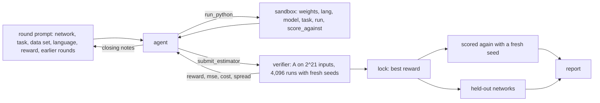

# ARC-agent

## Big picture

In this repo we consider an automated, agentic hill-climbing approach to the agenda of ARC (the Alignment
Research Center): explaining a network by **estimating its behaviour mechanistically**, from its weights, and
asking that such an estimate compete with random sampling at the same compute
([Competing with sampling](https://www.alignment.org/blog/competing-with-sampling/)). ARC's AlgZoo publishes tiny
networks with exactly this as the challenge: estimate the accuracy of a 432-parameter RNN better than sampling does
for the same compute ([AlgZoo](https://www.alignment.org/blog/algzoo-uninterpreted-models-with-fewer-than-1-500-parameters/)).

Here an agent writes an **estimator** of a network's accuracy, a verifier measures how far its estimates are from
the truth and how much compute they take, and the agent climbs that score round after round. It is the same
setup as [Mech-Interp-Agent-level1](https://github.com/WFJKK/Mech-Interp-Agent-level1), whose sandbox, backends and
priced language this repo builds on; there the agent wrote a cheaper predictor of the network's outputs, here it
writes a cheaper estimate of its accuracy.

## More formally

We have a network $M$, a data set $D$ (a distribution over inputs) and a task $y$. The network's accuracy is

```math
A = P_{x \sim D}\big(M(x) = y(x)\big).
```

An estimator $G$ is a program that computes one number, $\hat A$, from the network's weights; it may also draw
random numbers. It is written in a small language of priced operations
([`agent_docs/ESTIMATOR.md`](agent_docs/ESTIMATOR.md)), in which the network itself is written too, so that both are
priced by the same list. One run of $G$ spends $C$ forward-pass equivalents: its scalar operations over those of one
forward pass of $M$. Nothing of an estimator runs as code; the verifier interprets it, so it can do no work that
is not counted.

The verifier measures $A$ on inputs of its own, runs $G$ many times with fresh seeds, and keeps the error and the
cost of every run. Nothing is proved: an estimator is checked by measuring it.

## Reward function

### What we use

The agent's job is to estimate how often one fixed model gets the right answer. It gets a higher reward when its
estimate is closer to the verifier's accuracy and when it uses less compute.

```math
R_\lambda = -(\hat A - A_{\mathrm{verifier}})^2 - \lambda C
```

We calculate it in three steps.

1. **Measure the model's accuracy.** The verifier runs the checkpoint on labeled inputs and counts the fraction
   correct. For the 432-parameter AlgZoo RNN, it measured 95.3006% on 2,097,152 fresh inputs, and the worked
   example below uses $A_{\mathrm{verifier}} = 0.953006$. (This repo's verifier draws its own 2,097,152 inputs, with
   seed 20261124, and measures 0.953078: half a standard error away, which is 0.0146 points.)
2. **Score the agent's estimate.** The agent's estimator returns one number, $\hat A$. We take its difference from
   the reference and square it. Being one percentage point too high or too low gives the same penalty,
   $0.01^2 = 0.0001$.
3. **Charge for compute.** $C$ is the estimated number of scalar operations used to produce that estimate, divided
   by the cost of one ordinary model forward pass (2,937 operations for this RNN). At $\lambda = 10^{-6}$, 100
   forward-pass equivalents cost $0.0001$ reward. So spending 100 extra passes to eliminate a one-percentage-point
   error exactly breaks even.

**Worked example from round five.** We ran the RNN estimator 4,096 times with fresh randomness on the same
checkpoint. We squared the error of each estimate, then averaged. Its root mean squared error was 1.286 percentage
points, and its average cost was 109.86 forward-pass equivalents. Its average reward was therefore

```math
\bar R \approx -(0.0128565)^2 - 10^{-6} \cdot 109.86 = -0.00027515.
```

Higher is better. Monte Carlo enters afterward as a benchmark. At that same compute budget, ordinary Monte Carlo
had 2.031 percentage points of root mean squared error, so the agent's estimator achieved 59.9% lower mean squared
error.

For mechanistic understanding, the important limitation is that the formula scores only the estimate and its cost.
On this very checkpoint, the constant guess 95% missed by just 0.301 percentage points and earned a higher reward.

In code: `r_lambda` in [`arcagent/rewards.py`](arcagent/rewards.py), with `lam: 1.0e-6` in
[`config/defaults.yaml`](config/defaults.yaml). The verifier ([`arcagent/verifier.py`](arcagent/verifier.py)) runs
every submitted estimator 4,096 times, each run with the seed `[seed, k]` for a `seed` it draws afresh, and the
reward is the mean over the runs: $-\mathrm{mse} - \lambda \bar C$. Every receipt keeps the parts (mean squared
error, bias, spread of the estimates, mean, least and most cost, random draws per run), so a finished run can be
scored again under another $\lambda$ (`python -m arcagent.loop rescore`). The benchmark is computed for every
receipt but never shown to the agent: at mean cost $C$, plain sampling can afford $n = C/s$ inputs, where one more
sampled input costs $s = 2{,}989/2{,}937 = 1.0177$ forward passes here (ten draws, a forward pass, the task's answer,
a comparison), and its mean squared error is $A(1-A)/n$. Under $R_\lambda$ the best plain sampling takes
$n^* = \sqrt{A(1-A)/(\lambda s)}$ inputs and scores $-2\sqrt{\lambda s A(1-A)}$.

`docs/REWARD.md` has the details, the ways a reward like this can be gamed and what stops each.

### Measured here

The verifier's own numbers on the challenge network and on the held-out networks of the pilot (`models/rnn-g`;
reproduce with `python -m arcagent.report --model models/rnn-g --network rnn-g-s0`). Accuracies on 2,097,152
inputs; "sampling" is plain sampling, its error from $A(1-A)/n$; $\lambda = 10^{-6}$.

| Network | Accuracy | Constant 0.95: error (points) | Constant 0.95: reward | Sampling, 108 inputs (109.9 passes): rms error (points) | Its reward | Best sampling: inputs | Its reward |
| --- | ---: | ---: | ---: | ---: | ---: | ---: | ---: |
| rnn-g-s0 (the challenge network) | 0.953078 | -0.31 | -9.47e-06 | 2.035 | -5.24e-04 | 210 | -4.27e-04 |
| rnn-g-z0 | 0.909862 | +4.01 | -1.61e-03 | 2.756 | -8.69e-04 | 284 | -5.78e-04 |
| rnn-g-z1 | 0.880417 | +6.96 | -4.84e-03 | 3.122 | -1.09e-03 | 322 | -6.55e-04 |
| rnn-g-z2 | 0.948575 | +0.14 | -2.03e-06 | 2.125 | -5.62e-04 | 219 | -4.46e-04 |
| rnn-g-z3 | 0.931835 | +1.82 | -3.30e-04 | 2.425 | -6.98e-04 | 250 | -5.09e-04 |
| rnn-g-z4 | 0.889638 | +6.04 | -3.64e-03 | 3.015 | -1.02e-03 | 311 | -6.32e-04 |
| rnn-g-n1 | 0.944583 | +0.54 | -2.93e-05 | 2.202 | -5.95e-04 | 227 | -4.62e-04 |
| rnn-g-n2 | 0.845580 | +10.44 | -1.09e-02 | 3.477 | -1.32e-03 | 358 | -7.29e-04 |
| rnn-g-n3 | 0.693744 | +25.63 | -6.57e-02 | 4.435 | -2.08e-03 | 457 | -9.30e-04 |

- **The worked example's numbers come out here too.** Plain sampling of 108 inputs costs 109.9 forward passes; run
  4,096 times through the verifier it had 2.029 points of rms error (seed 1) and 2.085 (seed 0), against 2.035 from
  the formula and the 2.031 of the write-up. The constant 0.95 misses by 0.308 points here (0.301 against 0.953006).
- **The round-five estimator beats the best plain sampling** under $R_\lambda$: -2.75e-4 against -4.27e-4.
- **The constant shows the limitation.** It is the best entry in the table on the challenge network and on z2,
  whose accuracy happens to be close to 95%, and the worst by far on n2 and n3. Its mean reward over the eight
  held-out networks is -1.09e-2, against -6.2e-4 for the best plain sampling.

### What the reward does not see, and what the pipeline does about it

The agent's own code may run the network as much as it likes while exploring; only the estimator it submits is
charged. So the accuracy, measured in the sandbox and written into an estimator as a constant, scores near the top
of $R_\lambda$ on the run's network. Nothing in the reward stops that, by construction. The pipeline keeps the
reward as it is and makes the route visible instead, as level 1 did with its seed check:

- **Held-out networks.** When the rounds end, the locked estimator is run, unchanged, on networks of the same design
  the agent never sees: AlgZoo's five networks of this size (z0 to z4), trained from other random starts, and three
  copies of the challenge network with noise added to its weights (n1 to n3; 0.2%, 0.5% and 1% of each matrix's
  RMS). What an estimator computes from the weights is computed afresh there; a constant stays what it was. Every
  submission is also scored there after each round, for the record. The agent is told this happens, and that it
  does not change its reward.
- **The report** puts every estimator next to the constant of the run's own accuracy on each held-out network, and
  next to plain sampling at the same cost.
- **Another reward** is one function away in `arcagent/rewards.py`; the parts kept with every receipt allow
  rescoring a finished run without running anything.

## Agentic setup / Auto-research



A run is a sequence of rounds (at most 5, ending after 2 rounds without a higher reward). Each round is one fresh
session of the Claude Code CLI with two tools and nothing else:

- `run_python(code)`: Python in a sandbox, with the weights of the run's network, the estimator language `lang`,
  the network's definition `model` and the task's `task`, and the verifier's own code to run an estimator
  (`run`). It may sample the network freely; exploring is not charged.
- `submit_estimator(name)`: hands a saved estimator to the verifier and returns its reward, mean squared error,
  cost and the mean and spread of its estimates. The agent is never shown the network's accuracy, the bias of its
  estimates or the benchmark.

The next round's prompt carries every earlier submission's result and the agent's own closing notes. The agent is
told the task, the data set and the network, but not the network's accuracy, which network it is, or where it
comes from (the hygiene check searches everything the agent can reach for the accuracies and the names that would
lead to published figures, before every prompt).

## Results

No agent has run yet. The pilot is ready: `config/pilot/rnn-g.yaml` (the challenge network, 8 held-out networks,
5 rounds) and its one-round smoke test `config/pilot/rnn-g-smoke.yaml`. The reference numbers above are what any
run will be read against.

## More implementation details

### The estimator language

Prices are those of Mech-Interp-Agent-level1 (each operation on numbers costs 1, a matrix product 1 per
multiply-add, a reduction over n entries n - 1, moving data nothing) with three additions: random draws (`normal`,
`uniform`, `integers`, and `g.inputs(n)` for n inputs of the data set) at 1 per number drawn, `erf` and `power`.
A forward pass of the 432-weight RNN is 2,937 operations, as in level 1. Two things are new:

- **Runs.** Every random node draws from its own stream of the run's seed, so a run is reproducible from its seed
  and two scorings never share draws. Work that depends on no draw is the same in every run; the interpreter
  computes it once and keeps it, and every run is still charged for all of it that it uses. A run costs what it
  would cost alone (`tests/test_lang.py` checks this against fresh interpreters on random graphs).
- **One number out.** An estimator's result must be one finite number in every run; an estimator that draws
  nothing is run once and its result repeated.

### The verifier

For one network (`arcagent/verifier.py`):

1. $A$: the network on 2,097,152 inputs drawn with seed 20261124, 32,768 at a time, through the same interpreter
   (`Model.accuracy`; about 4 seconds). Measured once per run folder (`references.jsonl`).
2. The estimator, 4,096 times, run k with seed `[seed, k]`; `seed` drawn afresh for each scoring.
3. The parts: mean squared error, bias, spread, mean and range of the cost, draws per run; the reward; the
   benchmark. A scoring of a 100-pass estimator takes a few seconds.

`python -m arcagent.verifier --model models/rnn-g --network rnn-g-s0 --estimator e.json` scores an estimator file
on its own, with the benchmark, as the worked example does.

### The prompt

The system prompt of every session:

```text
You are working on a research task with two tools (run_python and submit_estimator) and no others; you have no files of your own. Use the tools as the message says, submit what you find, and end with the notes the message asks for, in exactly that format.
```

Every round's prompt is one template, [`prompts/round_v1.md`](prompts/round_v1.md), filled in from the model folder
(`model.py`, `task.py`, the sentences on the data set and the task), the guide
([`agent_docs/ESTIMATOR.md`](agent_docs/ESTIMATOR.md)), the reward's formula and explanation from
`arcagent/rewards.py`, the budgets, and the history. The agent ends each round with notes under fixed headings
(what the network does, how the estimator works, the best estimator, next), which are all the next round knows of
it besides the saved estimators.

## Getting started

### Install

    pip install -r requirements.txt
    python -m pytest                  # about two minutes; no model is called
    python -m pytest -m slow          # the recorded accuracies of all nine rnn-g networks, about a minute more

No GPU is needed: everything runs in numpy on a laptop, the networks included.

### Run a pilot

Start small. The smoke runs take one short round each:

    python -m arcagent.loop run --config config/pilot/rnn-b-smoke.yaml    # a 32-weight network: checks the install
    python -m arcagent.loop run --config config/pilot/rnn-g-smoke.yaml    # the challenge network, one round
    python -m arcagent.loop run --config config/pilot/rnn-g.yaml          # the pilot: 5 rounds, 8 held-out networks

Without `--auth api_key` a run uses your own Claude Code login (`claude` must be installed and logged in). Every
run can be tried first with scripted rounds and no model at all: `--fake tests/fake_run`.

### Stopping and resuming

Everything a run knows is in its folder, written as it happens, so it survives a dropped connection, a closed
laptop or Ctrl-C. A round is done when its `round.json` is written; a session that was cut off keeps its budgets,
its saved estimators and its submissions, and is told so when it starts again.

    python -m arcagent.loop resume --run ~/arc-agent-runs/pilot-rnn-g
    python -m arcagent.loop finish --run ~/arc-agent-runs/pilot-rnn-g      # the lock, the held-out check, the report

A usage limit is waited out; a login problem stops the run cleanly, and `resume` continues it.

### On an API key

`--auth api_key` bills the key in `CPL_ANTHROPIC_KEY` (never `ANTHROPIC_API_KEY`, which the backend removes), within
`budget.run_usd` (60 dollars) and `budget.round_usd` (20): `--budget-usd` changes the run's. The key is checked
against the API before the first round, at no cost, and never reaches a file or a log. Level 1's rnn-g pilot cost
about 27 dollars for 5 rounds on `claude-fable-5-1`; this task is of the same size.

### The sandbox

The agent's Python runs in the strongest sandbox available: a container (`python -m arcagent.sandbox build`),
Landlock on Linux, or a plain process with a guard inside Python (a fence, not a wall: a run that counts needs one
of the others). Every run starts by trying real escapes in the chosen mode. `docs/SANDBOX.md` has the details.

    python -m arcagent.sandbox info

### Other commands

    python -m arcagent.report --model models/rnn-g --network rnn-g-s0           # the reference estimators, no run
    python -m arcagent.verifier --model models/rnn-g --network rnn-g-s0 --estimator e.json --runs 4096
    python -m arcagent.loop rescore --run <run folder> --lam 1e-7               # the records under another lambda
    python withheld/rnn/convert.py                                             # check the weights against AlgZoo's files

### What a run writes

    run.json              the config, the commit, the hash of the trusted files, the sandbox and its probe
    log.jsonl             what happened, appended
    references.jsonl      the verifier's measurement of each network's accuracy
    round_001/            prompt.md, response.md, meta.json, round.json, stream_NN.jsonl (all the CLI emitted)
      session/            tools.jsonl, python/NNN.py and .txt (every program and its output),
                          submissions/NNN/ (estimator.json, receipt.json, runs.npz: every run's estimate and cost)
    heldout_scores.jsonl  every submission on every held-out network
    locked_estimator.json, lock.json, heldout_check.json, reference_scores.json
    report.md, report.json

## Repository layout

| Path | What |
| --- | --- |
| `arcagent/lang.py` | the estimator language: prices, random draws, the interpreter and the builder |
| `arcagent/networks.py` | model folders: the network and the task in the language, the accuracy measurement |
| `arcagent/verifier.py` | the verifier: the accuracy, the runs, the parts, the benchmark |
| `arcagent/rewards.py` | reward functions (`r_lambda`) and their texts for the prompt |
| `arcagent/session.py` | the agent's two tools and what its code is handed |
| `arcagent/loop.py` | the rounds, the lock, the held-out check, resume, rescore |
| `arcagent/report.py` | the report, and the reference estimators of a model |
| `arcagent/prompt.py`, `prompts/round_v1.md`, `agent_docs/ESTIMATOR.md` | everything the agent is told |
| `arcagent/hygiene.py` | the check that nothing withheld reaches the agent |
| `arcagent/sandbox.py`, `runner.py`, `harness.py` | where the agent's code runs (from level 1) |
| `arcagent/backends/` | the Claude Code CLI and the scripted stand-in (from level 1) |
| `arcagent/budget.py`, `run_config.py`, `mcp_server.py`, `util.py` | API budget, configs, the tool server, helpers |
| `models/rnn-g/` | the 432-weight challenge network and its held-out networks |
| `models/rnn-b/` | a 32-weight network of the same family, for smoke runs and tests |
| `withheld/` | what the agent must not see: accuracies, provenance, AlgZoo's original files, reference estimators |
| `config/` | defaults and the pilot configs |
| `docs/DESIGN.md`, `docs/REWARD.md`, `docs/SANDBOX.md` | the design, the reward and its gaming routes, the sandbox |
| `tests/` | all of it, with scripted rounds in place of a model |
